<div align="center">


<br/><br/>

```
███████╗███╗   ██╗████████╗███████╗██████╗ ██████╗ ██████╗ ██╗███████╗███████╗
██╔════╝████╗  ██║╚══██╔══╝██╔════╝██╔══██╗██╔══██╗██╔══██╗██║██╔════╝██╔════╝
█████╗  ██╔██╗ ██║   ██║   █████╗  ██████╔╝██████╔╝██████╔╝██║███████╗█████╗  
██╔══╝  ██║╚██╗██║   ██║   ██╔══╝  ██╔══██╗██╔═══╝ ██╔══██╗██║╚════██║██╔══╝  
███████╗██║ ╚████║   ██║   ███████╗██║  ██║██║     ██║  ██║██║███████║███████╗
╚══════╝╚═╝  ╚═══╝   ╚═╝   ╚══════╝╚═╝  ╚═╝╚═╝     ╚═╝  ╚═╝╚═╝╚══════╝╚══════╝

    H Y B R I D   N E T W O R K   A R C H I T E C T U R E
```

### *A production-grade corporate network — simulated end to end in Cisco Packet Tracer*

**Headquarters · Branch Office · Work-From-Home · ISP · Public Internet**

</div>

---

<div align="center">

## 🏆 What Makes This Project Stand Out

</div>

> This isn't just a school exercise. This is a **complete, working simulation of how real enterprise networks are built** — from physical cabling and VLAN segmentation to dynamic routing, VPN tunnels, NAT, and security policies. Every device is configured using **real Cisco IOS commands**. Every feature is verified and tested.

<br/>

<div align="center">

| 🌐 Multi-Site | 🔐 Secure | 🏠 Remote Access | ⚡ Redundant | 🛠️ Fully Documented |
|:---:|:---:|:---:|:---:|:---:|
| HQ + Branch + WFH | VPN + ACL + NAT | Work-From-Home VPN | EtherChannel + STP | 42 files, 10 docs |

</div>

---

## 📡 Network Topology

```
                        🏠 WFH ZONE
              ┌─────────────────────────┐
              │  WFH-PC1    WFH-PC2     │
              │  172.16.1.10  .11       │
              │       └──────┘          │
              │      HOME-R1            │
              │      192.0.2.30 (WAN)   │
              └───────────┬─────────────┘
                          │
                ══════════╪══════════════════════════════╗
                GRE TUNNEL│(simulated Remote Access VPN)  ║
                ══════════╪══════════════════════════════╝
                          │                               ║
              ┌───────────▼───────────┐       ┌──────────▼─────────────────────┐
              │        ISP-R1         │       │          HQ-R1 (VPN Headend)   │
              │       192.0.2.1       │       │          203.0.113.2            │
              │  ┌────────────────┐   │       └──────────────┬─────────────────┘
              │  │  PUBLIC-SRV1   │   │                      │
              │  │  192.0.2.10    │   │                   HQ-SW1
              │  └────────────────┘   │               (STP Root Bridge)
              └──┬──────────────┬─────┘             ┌────────┴────────┐
                 │              │                   Po1             Po2
                 │              │               (LACP)            (LACP)
              HQ-R1          BR-R1              HQ-SW2          HQ-SW3
           203.0.113.2    198.51.100.2             └───────┬────────┘
                │                │                         │
             HQ-SW1           BR-SW1               ┌───────┴──────────────────┐
          ┌────┴────┐       ┌────┴────┐           VLAN10  VLAN20  VLAN30   VLAN40
        SW2        SW3    SALES    BR-IT            HR    Finance   Dev       IT
          └────┬────┘
        STP + EtherChannel
```

<br/>

---

## 🗺️ Live Simulation Screenshots

<table>
<tr>
<td align="center" width="50%">

**🖥️ Complete Network Topology**
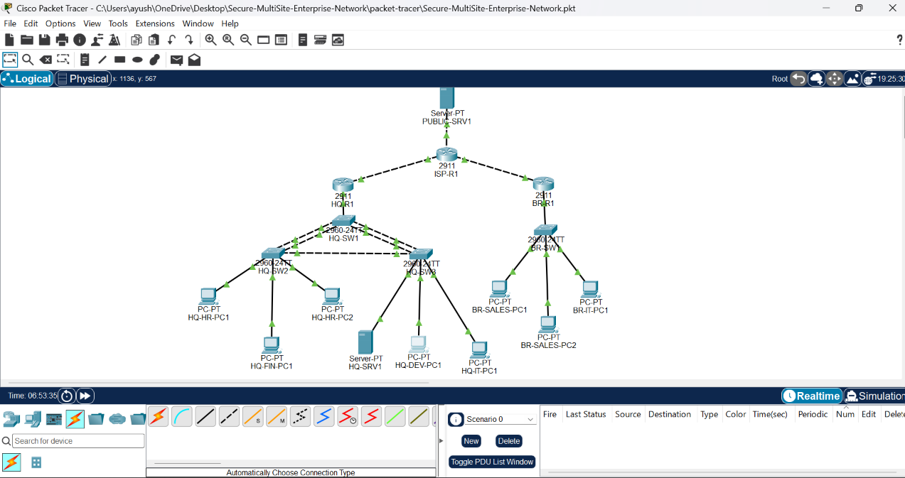

</td>
<td align="center" width="50%">

**🔗 VLAN Configuration**
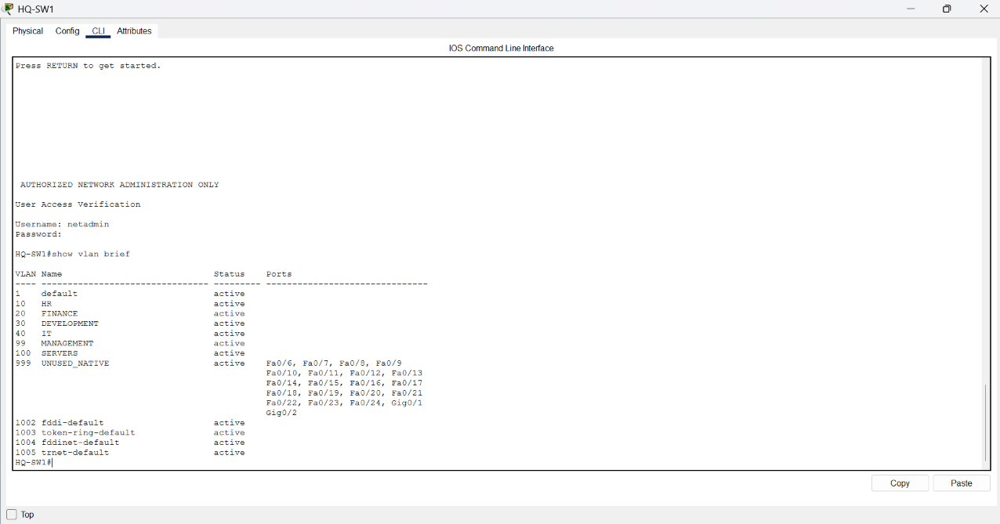

</td>
</tr>
<tr>
<td align="center">

**⛓️ EtherChannel / LACP Status**
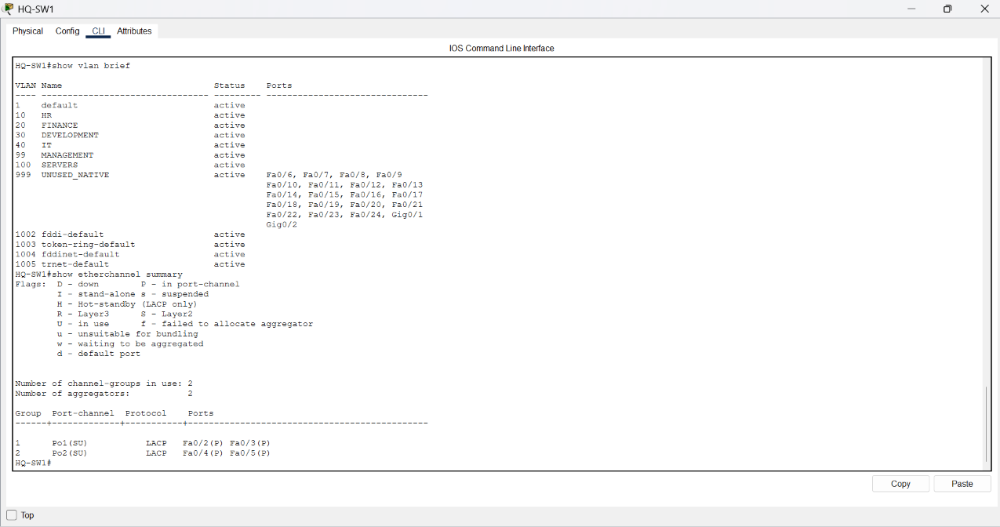

</td>
<td align="center">

**🌳 Spanning Tree Protocol**
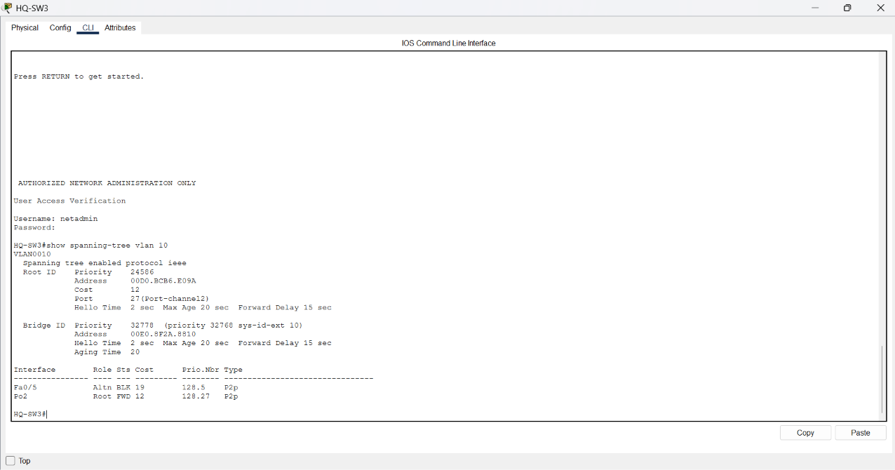

</td>
</tr>
<tr>
<td align="center">

**🛣️ OSPF Neighbor Relationships**
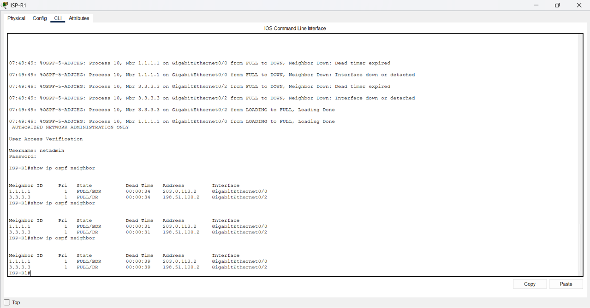

</td>
<td align="center">

**📋 DHCP Address Allocation**
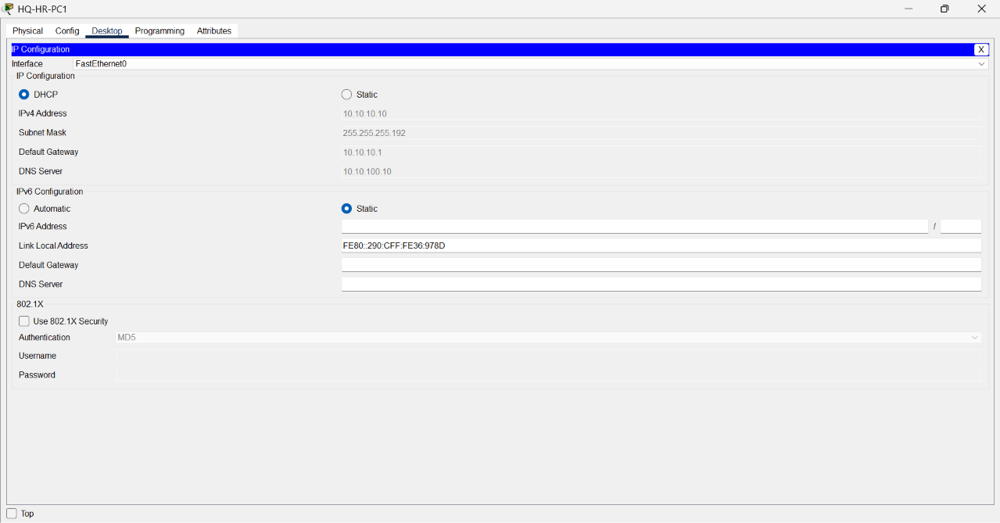

</td>
</tr>
<tr>
<td align="center">

**🌐 Internal DNS + Web Server**
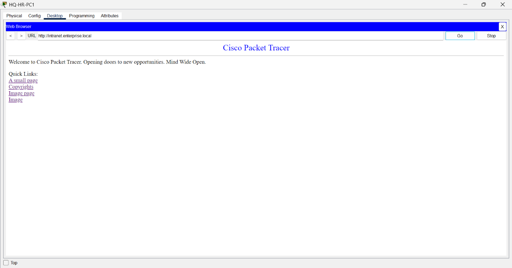

</td>
<td align="center">

**🏢 Multi-Site Connectivity**
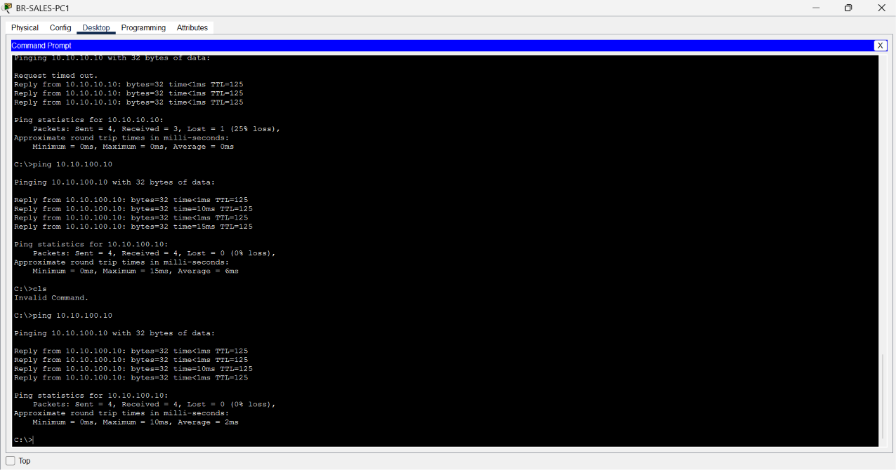

</td>
</tr>
<tr>
<td align="center">

**🔀 NAT / PAT Translations**
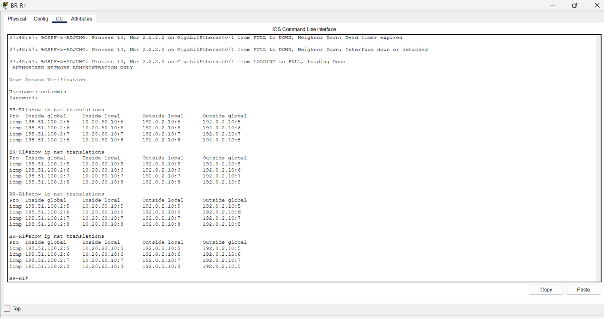

</td>
<td align="center">

**🔒 ACL Security Policy**
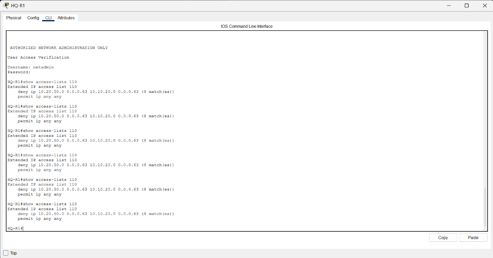

</td>
</tr>
<tr>
<td align="center" colspan="2">

**🌍 Public Server Connectivity**
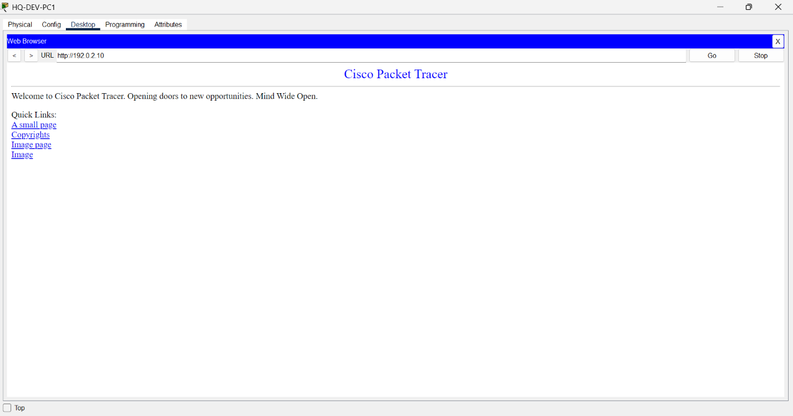

</td>
</tr>
</table>

---

## 🏗️ Architecture Overview

### Three Sites. One Network.

<details>
<summary><b>🏢 Head Office (HQ) — Click to expand</b></summary>
<br/>

The nerve centre of the enterprise. Hosts all critical infrastructure.

| Device | Role |
|---|---|
| `HQ-R1` (Cisco 2911) | Core router — inter-VLAN, OSPF, NAT, VPN headend |
| `HQ-SW1` (Cisco 2960) | Distribution switch — STP root, EtherChannel hub |
| `HQ-SW2` (Cisco 2960) | Access switch — connected via LACP Port-Channel 1 |
| `HQ-SW3` (Cisco 2960) | Access switch — connected via LACP Port-Channel 2 |
| `HQ-SRV1` | Internal DNS + HTTP web server |

**Department VLANs:**

| VLAN | Department | Subnet | Gateway |
|:---:|---|---|---|
| `10` | 👥 HR | `10.10.10.0/26` | `10.10.10.1` |
| `20` | 💰 Finance | `10.10.20.0/26` | `10.10.20.1` |
| `30` | 💻 Development | `10.10.30.0/25` | `10.10.30.1` |
| `40` | 🔧 IT | `10.10.40.0/27` | `10.10.40.1` |
| `99` | 🛡️ Management | `10.10.99.0/28` | `10.10.99.1` |
| `100` | 🖥️ Servers | `10.10.100.0/28` | `10.10.100.1` |
| `999` | 🚫 Native/Unused | — | — |

</details>

<details>
<summary><b>🏢 Branch Office — Click to expand</b></summary>
<br/>

A remote office connected to HQ through the simulated ISP via OSPF routing.

| Device | Role |
|---|---|
| `BR-R1` (Cisco 2911) | Branch router — inter-VLAN, OSPF, NAT |
| `BR-SW1` (Cisco 2960) | Branch access switch |

**Department VLANs:**

| VLAN | Department | Subnet | Gateway |
|:---:|---|---|---|
| `50` | 🛒 Sales | `10.20.50.0/26` | `10.20.50.1` |
| `60` | 🔧 Branch IT | `10.20.60.0/27` | `10.20.60.1` |
| `99` | 🛡️ Management | `10.20.99.0/28` | `10.20.99.1` |

</details>

<details>
<summary><b>🏠 Work-From-Home (WFH) Zone — Click to expand</b></summary>
<br/>

Remote employees working from home, securely connected to the corporate network via a **GRE tunnel** (simulating a Remote Access VPN).

| Device | Role |
|---|---|
| `HOME-R1` (Cisco 2911) | Home router — NAT + GRE VPN client |
| `WFH-PC1` | Remote employee workstation 1 |
| `WFH-PC2` | Remote employee workstation 2 |

**WFH Network:**

| Item | Value |
|---|---|
| Home LAN | `172.16.1.0/24` |
| HOME-R1 Public IP | `192.0.2.30` |
| GRE Tunnel (WFH end) | `10.30.0.2` |
| GRE Tunnel (HQ end) | `10.30.0.1` |
| DNS Server (via tunnel) | `10.10.100.10` |
| Intranet (via tunnel) | `http://intranet.enterprise.local` |

**Security Policy for WFH users:**
```
✅  WFH → HQ HR, Development, IT      ALLOWED
✅  WFH → HQ Internal Server          ALLOWED
✅  WFH → Branch Office               ALLOWED
❌  WFH → HQ Finance                  BLOCKED  (ACL 110)
```

</details>

---

## ⚙️ Technologies & Features

### Layer 2 — Switching

| Feature | Implementation | Status |
|---|---|:---:|
| **VLANs** | 7 VLANs at HQ, 4 at Branch — full departmental isolation | ✅ |
| **802.1Q Trunking** | Multi-VLAN trunks between all switches and routers, Native VLAN 999 | ✅ |
| **EtherChannel (LACP)** | Port-Channel 1 (SW1↔SW2) + Port-Channel 2 (SW1↔SW3) | ✅ |
| **STP (PVST)** | HQ-SW1 as root bridge; redundant paths controlled without loops | ✅ |

### Layer 3 — Routing

| Feature | Implementation | Status |
|---|---|:---:|
| **Router-on-a-Stick** | Subinterfaces (G0/0.10 → G0/0.100) for inter-VLAN routing | ✅ |
| **OSPF (Area 0)** | Dynamic route exchange between HQ-R1, ISP-R1, BR-R1 | ✅ |

```
OSPF Router IDs:
  HQ-R1  →  1.1.1.1
  ISP-R1 →  2.2.2.2
  BR-R1  →  3.3.3.3
```

### Services

| Service | Details | Status |
|---|---|:---:|
| **DHCP** | Auto IP for HR, Finance, Dev, IT (HQ) + Sales, Branch IT (Branch) | ✅ |
| **DNS** | `intranet.enterprise.local → 10.10.100.10` | ✅ |
| **HTTP** | `http://intranet.enterprise.local` — accessible from all sites + WFH | ✅ |

### Security

| Feature | Implementation | Status |
|---|---|:---:|
| **NAT / PAT** | HQ Dev (`10.10.30.0/25`) → `203.0.113.2`; Branch IT → `198.51.100.2` | ✅ |
| **Extended ACL 110** | Blocks Sales + WFH from Finance; permits all other traffic | ✅ |
| **SSH v2** | All routers and switches — no Telnet allowed | ✅ |
| **Device Hardening** | Enable secret, password encryption, banners, idle timeouts, unused ports shutdown | ✅ |
| **GRE Tunnel VPN** | WFH ↔ HQ encrypted virtual link over public internet | ✅ |
| **IPsec Site-to-Site VPN** | HQ ↔ Branch — IKE/AES/SHA design complete | 📐 Designed |
| **IPsec Remote Access VPN** | WFH → HQ — EasyVPN design complete | 📐 Designed |

> 📐 *IPsec designs are fully documented and ready for deployment in GNS3, EVE-NG, or Cisco CML. Packet Tracer's 2911 IOS image doesn't activate the SecurityK9 package required for live crypto commands.*

---

## ✅ Verification Results

<div align="center">

| # | Test | Result |
|:---:|---|:---:|
| 1 | VLAN segmentation — all departments isolated | ✅ PASS |
| 2 | 802.1Q trunks — all VLANs traversing correctly | ✅ PASS |
| 3 | EtherChannel — `Po1(SU)` and `Po2(SU)` active | ✅ PASS |
| 4 | STP — HQ-SW1 is root; redundant ports blocking | ✅ PASS |
| 5 | OSPF — all neighbours in `FULL` state | ✅ PASS |
| 6 | Inter-VLAN routing — cross-VLAN pings succeed | ✅ PASS |
| 7 | DHCP — all PCs auto-assigned correct IPs | ✅ PASS |
| 8 | DNS — `nslookup intranet.enterprise.local` resolves | ✅ PASS |
| 9 | Internal web server — loads from HQ, Branch, WFH | ✅ PASS |
| 10 | HQ ↔ Branch connectivity — bidirectional | ✅ PASS |
| 11 | Public server (`192.0.2.10`) — reachable from all sites | ✅ PASS |
| 12 | NAT/PAT — translations confirmed with `show ip nat translations` | ✅ PASS |
| 13 | ACL 110 — Finance blocked from Sales + WFH; HR accessible | ✅ PASS |
| 14 | SSH management — all devices secured, Telnet disabled | ✅ PASS |
| 15 | GRE tunnel — `Tunnel10 up/up` on both HQ-R1 and HOME-R1 | ✅ PASS |
| 16 | WFH access — HQ server, DNS, web reachable from home | ✅ PASS |
| 17 | WFH Finance block — ping to `10.10.20.x` times out | ✅ PASS |
| 18 | Site-to-Site IPsec VPN | 📐 Designed |
| 19 | IPsec Remote Access VPN | 📐 Designed |

</div>

---

## 📁 Project Structure

```
Enterprise-Hybrid-Network-Architecture/
│
├── 📄 README.md
│
├── 📂 packet-tracer/
│   └── 🗂️  Enterprise-Hybrid-Network-Architecture.pkt   ← Open in Packet Tracer
│
├── 📂 configs/
│   ├── 📂 routers/
│   │   ├── HQ-R1.txt                    ← HQ core router
│   │   ├── ISP-R1.txt                   ← Simulated ISP
│   │   ├── BR-R1.txt                    ← Branch router
│   │   ├── HOME-R1.txt                  ← WFH home router (GRE VPN)
│   │   ├── HQ-R1-NAT-PAT.txt            ← NAT overload config
│   │   ├── BR-R1-NAT-PAT.txt            ← Branch NAT config
│   │   ├── HQ-R1-ACL.txt               ← Extended ACL 110
│   │   ├── HQ-R1-GRE-WFH.txt           ← GRE tunnel + updated ACL
│   │   ├── HQ-R1-Remote-Access-VPN.txt  ← IPsec RA VPN design
│   │   ├── HQ-R1-VPN.txt               ← Site-to-Site IPsec design
│   │   └── BR-R1-VPN.txt               ← Branch IPsec design
│   │
│   └── 📂 switches/
│       ├── HQ-SW1.txt    ← Root bridge, EtherChannel, PVST
│       ├── HQ-SW2.txt
│       ├── HQ-SW3.txt
│       └── BR-SW1.txt
│
├── 📂 documentation/
│   ├── Network-Design.txt
│   ├── IP-Addressing-Plan.txt
│   ├── VLAN-Plan.txt
│   ├── Port-Mapping.txt
│   ├── Cabling-Plan.txt
│   ├── NAT-PAT-Plan.txt
│   ├── ACL-Security-Policy.txt
│   ├── VPN-Plan.txt
│   ├── WFH-Remote-Access-Plan.txt
│   └── Packet-Tracer-WFH-Setup-Guide.txt  ← Step-by-step WFH setup
│
├── 📂 testing/
│   ├── Verification-Plan.txt
│   ├── Final-Testing-Report.txt
│   └── WFH-Testing-Report.txt
│
└── 📂 screenshots/
    ├── 01-complete-network-topology.png
    ├── 02-vlan-configuration.png
    ├── 03-etherchannel-status.png
    ├── 04-stp-status.png
    ├── 05-ospf-neighbors.png
    ├── 06-dhcp-allocation.png
    ├── 07-dns-internal-web-server.png
    ├── 08-multisite-connectivity.png
    ├── 09-nat-pat-translations.png
    ├── 10-acl-security.png
    └── 11-public-server-access.png
```

---

## 🚀 Getting Started

**Requirements:** [Cisco Packet Tracer](https://www.netacad.com/courses/packet-tracer) (free with Cisco NetAcad account)

```bash
# Clone the repository
git clone https://github.com/RathinRH/Enterprise-Hybrid-Network-Architecture.git

# Open the simulation
# → packet-tracer/Enterprise-Hybrid-Network-Architecture.pkt
```

**To add WFH support to the simulation**, follow the step-by-step guide:
```
documentation/Packet-Tracer-WFH-Setup-Guide.txt
```

**Lab credentials** (simulation only — never use in production):

| Role | Username | Password |
|---|---|---|
| Router / Switch admin | `netadmin` | `Admin@12345` |
| Privileged EXEC mode | — | `Cisco@12345` |
| WFH VPN users | `wfh-user1` / `wfh-user2` | `Wfh@12345` |

---

## 🧰 Tech Stack

<div align="center">

| Layer | Technology |
|---|---|
| **Simulation** | Cisco Packet Tracer |
| **Devices** | Cisco 2911 Router, Cisco 2960 Switch |
| **L2 Protocols** | 802.1Q VLAN Trunking, LACP EtherChannel, PVST Spanning Tree |
| **L3 Protocols** | OSPF (Area 0), Router-on-a-Stick, Static Routing |
| **Services** | DHCP, DNS, HTTP |
| **Security** | NAT/PAT, Extended ACL, SSH v2, GRE Tunnel VPN, IPsec (designed) |
| **WAN Simulation** | Point-to-point GigabitEthernet links via ISP router |

</div>

---

## 📚 Skills Demonstrated

```
✦ Enterprise Network Design        ✦ IPv4 Subnetting (VLSM)
✦ VLAN Architecture                ✦ Layer 2 Redundancy
✦ Dynamic Routing (OSPF)           ✦ Inter-VLAN Routing
✦ Network Services (DHCP/DNS/HTTP) ✦ NAT / PAT
✦ Perimeter Security (ACL)         ✦ VPN Design (GRE + IPsec)
✦ Remote Access (WFH)              ✦ Cisco IOS Configuration
✦ Network Troubleshooting          ✦ Technical Documentation
```

---

<div align="center">

---

*Developed for educational and portfolio purposes using Cisco Packet Tracer.*
*All credentials and IP addresses are simulation-only and must not be used in production.*

---

**⭐ If this project helped you, consider giving it a star!**

</div>
